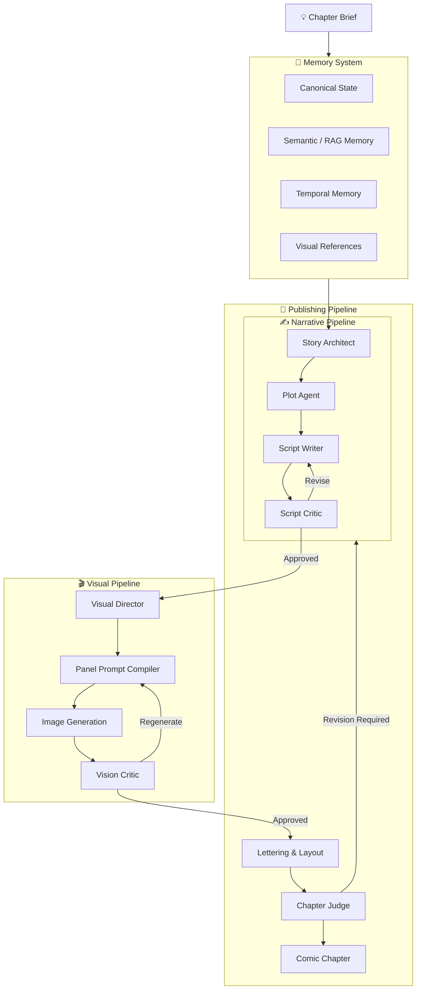
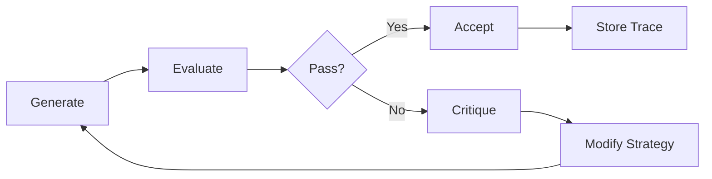
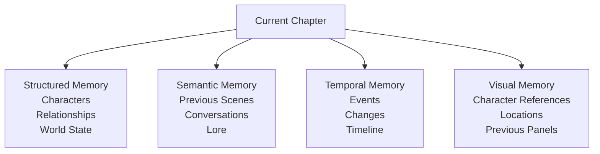
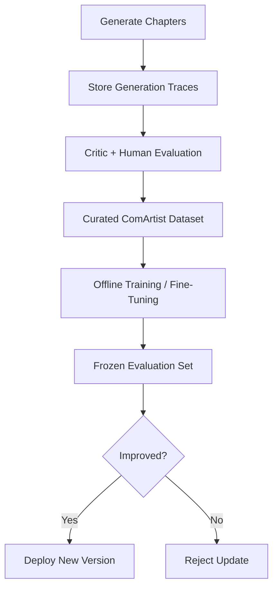
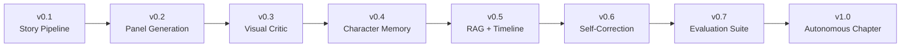

# 🎨 ComArtist

> **An autonomous multi-agent system that turns ideas into coherent, evolving comic chapters.**

ComArtist is an experimental **Agentic AI comic-production system** designed to transform a simple story idea into a complete comic chapter.

Instead of treating comic generation as:

```text
Prompt → Image
```

ComArtist treats it as a long-running creative workflow:

```text
Idea → Memory Retrieval → Story → Script → Visual Direction
     → Panel Generation → Critique → Revision → Comic Chapter
```

The goal is not simply to generate attractive images.

The goal is to build an AI system capable of maintaining **characters, relationships, story continuity, visual identity, world state, and narrative history across potentially hundreds of chapters.**

---

# 💡 Why ComArtist?

Current generative models can already produce:

- stories
- dialogue
- illustrations
- comic-style images

But generating **one image** is very different from maintaining a coherent comic universe.

A long-running comic introduces problems such as:

- Does the character still look like the same person 40 panels later?
- Does their personality remain consistent?
- Does the system remember something that happened 20 chapters ago?
- Does a character know information they have not learned yet?
- Is someone wearing the correct clothes after changing outfits?
- Does a location remain visually recognizable?
- Does the generated panel actually match the script?
- Can the system detect its own mistakes and repair them?

ComArtist explores these problems using **multi-agent orchestration, multimodal generation, persistent memory, RAG, visual conditioning, automated evaluation, and iterative self-correction.**

---

# 🧠 Core Idea

The user should not have to write an entire screenplay.

A chapter could start with something as simple as:

```yaml
timeframe: Summer 2024
location: New York City

characters:
  - Matt
  - Andy

canon:
  - Andy moved to NYC in 2020.
  - Matt and Andy have not met since middle school.
  - Matt is in the United States for Work & Travel.
  - They meet near NYU.
  - They go to a pub where Harry Potter is playing.
  - They spend the evening catching up about their lives.

tone:
  - nostalgic
  - funny
  - grounded
  - bittersweet

target_pages: 18
```

ComArtist should determine the rest.

For example:

- Where exactly should the chapter begin?
- Who arrives first?
- How awkward is the reunion?
- What memories naturally come up?
- When should the conversation become serious?
- How should the visual framing change?
- What should the final emotional beat be?

The user provides **truth and intent**.

The agents provide **creative execution**.

---

# 🏗️ System Architecture



---

# 🤖 Agent System

ComArtist is designed around specialized agents rather than one giant prompt.

### Story Architect

Transforms the user's chapter idea into a dramatic structure while respecting existing canon.

### Plot Agent

Creates the sequence of events, emotional progression, pacing, and page-level beats.

### Script Writer

Produces:

- panel descriptions
- dialogue
- captions
- actions
- expressions
- scene transitions

### Script Critic

Evaluates:

- pacing
- dialogue
- characterization
- continuity
- contradictions
- narrative quality

Failed scripts enter a:

```text
Writer → Critic → Revision → Critic
```

loop.

### Lore / Continuity Agent

Tracks the evolving universe:

```text
characters
relationships
locations
events
knowledge
objects
injuries
outfits
timeline
world rules
```

### Visual Director

Converts narrative instructions into visual direction:

- framing
- composition
- camera angle
- pose
- lighting
- emotion
- character placement
- environmental context

### Panel Generator

Produces panels using diffusion / image-generation models with visual conditioning.

### Vision Critic

Uses a multimodal model to evaluate generated panels.

Example evaluation:

```json
{
  "character_identity": 0.94,
  "outfit_consistency": 0.97,
  "pose_accuracy": 0.82,
  "script_alignment": 0.91,
  "environment_consistency": 0.88,
  "visual_quality": 0.90,
  "requires_regeneration": false
}
```

### Chapter Judge

Evaluates the complete chapter rather than isolated panels.

It checks whether the final result works as a **sequential narrative**.

---

# 🔁 Self-Correction

A core principle of ComArtist is:

> **Generation is not completion. Generation is a candidate.**



Instead of blindly regenerating panels, ComArtist should understand **why** something failed.

Examples:

```text
WRONG_CHARACTER_IDENTITY
WRONG_OUTFIT
POSE_MISMATCH
MISSING_CHARACTER
MISSING_OBJECT
CONTINUITY_VIOLATION
STYLE_DRIFT
SCRIPT_MISMATCH
DIALOGUE_ERROR
BAD_COMPOSITION
```

Those failures become valuable data for improving the system later.

---

# 🧠 Long-Term Memory

ComArtist is intended to support stories that evolve over **years and potentially hundreds of chapters**.

That requires more than ordinary conversation history.

The memory architecture separates different kinds of knowledge.



For example:

```text
2020
Aral moves to New York City.

2024
Mert visits the United States through Work & Travel.

Summer 2024
Mert and Aral meet again for the first time since middle school.
```

If ComArtist later generates a flashback set in **2019**, it must understand that:

```text
Aral has NOT moved to NYC yet.
```

Long-term memory therefore needs to represent not only:

> **What is true?**

but:

> **When was it true?**

---

# 🧩 Canon vs Creativity

ComArtist separates information into three categories.

### Canon

Facts established by the user or previously accepted chapters.

```text
Aral moved to NYC in 2020.
```

Agents cannot silently modify canon.

### Derived Information

Reasonable conclusions based on existing canon.

```text
Aral probably knows NYC better than Mert.
```

### Ephemeral Fiction

Scene-level details the agents are free to invent.

```text
Aral jokes that Mert still orders the same drink he liked years ago.
```

This distinction allows agents to be creative without hallucinating permanent facts about the story universe.

---

# 🧬 Learning & Improvement

ComArtist does **not** continuously retrain itself on everything it generates.

Instead:



Generation traces can eventually provide training examples containing:

```text
story context
+
character references
+
panel specification
+
generated image
+
critic evaluation
+
failure reason
+
revised generation
+
human preference
```

This creates a domain-specific dataset for improving:

- visual critics
- character consistency
- generation policies
- story evaluators
- prompt compilation
- LoRA adapters

---

# 🗃️ Example State

```text
ComicState
│
├── Series
│   ├── title
│   ├── premise
│   ├── genre
│   └── world_rules
│
├── Characters
│   ├── identity
│   ├── appearance
│   ├── personality
│   ├── relationships
│   └── visual_references
│
├── Timeline
│
├── Chapters
│   ├── chapter_001
│   ├── chapter_002
│   └── ...
│
├── CurrentChapter
│   ├── beats
│   ├── pages
│   └── panels
│
└── GenerationHistory
    ├── attempts
    ├── critiques
    ├── scores
    └── revisions
```

---

# 🛠️ Planned Tech Stack

### Core

```text
Python
Pydantic
PyTorch
```

### Agentic AI

```text
LangGraph
LangChain
LiteLLM
LangSmith
```

### Hugging Face

```text
Transformers
Diffusers
PEFT
Accelerate
Datasets
Hugging Face Hub
```

### Visual Consistency

```text
LoRA
IP-Adapter
ControlNet
Vision-Language Models
```

### Memory

```text
PostgreSQL
Qdrant
Embeddings
RAG
Temporal Memory
```

### Model Serving

```text
vLLM
```

### Interface

```text
Streamlit
```

### Infrastructure

```text
Docker
Docker Compose
GitHub Actions
pytest
```

---

# 🖥️ UI Philosophy

The interface is intentionally simple.

ComArtist is primarily an **AI systems project**, not a frontend project.

```text
┌──────────────────────────────────────────────┐
│                  ComArtist                   │
├──────────────────────────────────────────────┤
│                                              │
│  What happens in this chapter?               │
│                                              │
│  ┌────────────────────────────────────────┐  │
│  │ Summer 2024. Mert meets his old...    │  │
│  └────────────────────────────────────────┘  │
│                                              │
│  Characters: Mert, Aral                      │
│  Target pages: 18                            │
│                                              │
│           [ Generate Chapter ]               │
│                                              │
├──────────────────────────────────────────────┤
│ Pipeline                                     │
│                                              │
│ ✓ Memory Retrieval                           │
│ ✓ Story Architect                            │
│ ✓ Plot Agent                                 │
│ ✓ Script Writer                              │
│ ↻ Script Critic                              │
│ ○ Visual Director                            │
│ ○ Panel Generator                            │
│ ○ Vision Critic                              │
│ ○ Chapter Judge                              │
└──────────────────────────────────────────────┘
```

Streamlit is sufficient for exposing:

- story input
- character management
- pipeline status
- generated pages
- critic scores
- agent traces
- regeneration history
- cost metrics

---

# 📊 Evaluation

ComArtist should be measurable.

Possible metrics include:

| Metric | Description |
|---|---|
| Character Identity | Does the character remain recognizable? |
| Visual Continuity | Are appearance and environment consistent? |
| Script Alignment | Does the panel depict what the script requested? |
| Narrative Coherence | Does the chapter make sense sequentially? |
| Canon Violations | How often does the system contradict established facts? |
| First-Pass Success | Percentage of panels accepted without regeneration |
| Regeneration Rate | Average attempts required per accepted panel |
| Cost / Panel | Average generation cost |
| Cost / Chapter | Total inference cost |
| Human Preference | Human evaluation of final output |

An eventual target could look like:

```text
20-page chapter
~100 final panels

Character consistency     ≥ 90%
Script alignment          ≥ 90%
Narrative coherence       ≥ 90%
Canon violations          < 2%
Average generations       ≤ 2.5 / panel
Target chapter cost       ≤ $15
```

---

# 🧪 Research Questions

ComArtist explores questions including:

### Can an agentic system maintain character identity across long visual sequences?

### Can multimodal agents identify and repair their own continuity errors?

### How should long-term narrative memory be represented?

### Can structured memory and RAG complement each other for fictional universes?

### Can generation policies learn which conditioning strategies work best for different scenes?

### How much autonomous revision is necessary before additional inference cost stops improving quality?

### Can a system maintain coherent canon across 100+ chapters?

---

# 🗺️ Development Roadmap



### Phase 1 — Narrative MVP

- [ ] Define `ComicState`
- [ ] Story Architect
- [ ] Plot Agent
- [ ] Script Writer
- [ ] Script Critic
- [ ] LangGraph orchestration
- [ ] Basic Streamlit UI

### Phase 2 — Visual Generation

- [ ] Panel specification schema
- [ ] Visual Director
- [ ] Diffusers integration
- [ ] Character reference conditioning
- [ ] Panel generation

### Phase 3 — Evaluation

- [ ] VLM Critic
- [ ] Failure taxonomy
- [ ] Panel scoring
- [ ] Automated regeneration
- [ ] Generation traces

### Phase 4 — Memory

- [ ] Character memory
- [ ] World-state database
- [ ] Qdrant RAG
- [ ] Temporal memory
- [ ] Visual memory
- [ ] Canon validation

### Phase 5 — Learning

- [ ] ComArtistBench
- [ ] Human evaluation pipeline
- [ ] Critic fine-tuning
- [ ] Character LoRA training
- [ ] Generation-policy optimization
- [ ] Regression evaluation

### Phase 6 — Full Chapter Generation

```text
One Idea
   ↓
Zero Manual Intervention
   ↓
Complete Comic Chapter
   ↓
Evaluation Report + Generation Trace
```

---

# 🎯 Long-Term Goal

The long-term vision is simple:

> Give ComArtist a few sentences about something that happened — or something that should happen — and receive a complete comic chapter that understands everything that came before it.

After dozens or hundreds of chapters, the system should understand:

- who the characters are
- what they look like
- how they speak
- how their relationships changed
- where they have been
- what they know
- what they have experienced
- how the world evolved

without requiring the entire history to be manually explained again.

---

# ⚠️ Status

> 🚧 **Early Research / Development**

ComArtist is currently being designed and implemented.

The initial focus is not maximum image quality.

The initial focus is proving that a multi-agent architecture can reliably coordinate:

```text
Memory
+
Narrative Planning
+
Visual Generation
+
Evaluation
+
Self-Correction
```

across an entire sequential comic chapter.

---

# 📜 License

License TBD.

---

<p align="center">
  <strong>ComArtist</strong><br>
  Turning ideas into evolving comic worlds.
</p>
